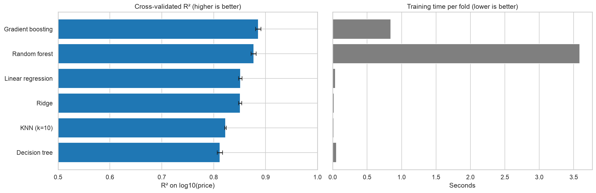

# Predicting House Prices in King County

**Team:** 
- Karthikeyan Saravanan
- Emmanuel Marquez
- Bars babila
- Samiha Abeda Nur
  
**Course:** AI Methods I – Day 2: Supervised learning (IAAC MaAI 2026/27)  
**Model on Hugging Face:**

## Use case
This project develops a machine learning model to predict residential property prices in King County, Washington, based on housing characteristics and location. 

The model is intended to help real estate professionals, buyers, and investors estimate property values and support informed decisions. 

## Dataset

| Field | Description |
|---|---|
| **Name** | King County House Sales |
| **Period** | 2014–2015 |
| **Rows used** | 20,703 after cleaning |
| **Columns in cleaned dataset** | 19 |
| **Training set** | 16,556 sales |
| **Test set** | 4,147 sales |

We reuse the cleaned dataset from Day 1. Cleaning included converting
dates, removing the waterfront and view columns, and filtering extreme
observations in price, living area and bedroom count.

## Repository structure
```
├── data/        # downloaded and cleaned data (not committed)
├── figures/     # exported plots
├── models/      # model card (README.md); model.joblib lives on Hugging Face
├── notebook/    # supervised_learning.ipynb (+ data_cleaning_and_EDA.ipynb if new dataset)
...
```

## How to run
```bash
python -m venv .venv
source .venv/bin/activate        # Windows: .venv\Scripts\activate
pip install -r requirements.txt
```
Open `notebook/supervised_learning.ipynb`, select the `.venv` kernel and run all cells.
(If you switched datasets: run `notebook/data_cleaning_and_EDA.ipynb` first. It creates the cleaned dataset that the second notebook loads.)

## Approach
- **Target:** price (regression),main metric:R2, because it measures how much of the variation in housing prices is explained by the model
- **Features:** sqft_living, sqft_lot, floors, condition, grade, yr_built, yr_renovated, lat, and long. (removed: waterfront and view because they contain mostly the number 0 and we considered the availabe information insufficient for imputation)
- **Preprocessing:** Numerical preprocessing using scikit-learn pipelines, including scaling where appropriate. Geographic data leakage is reduced through 5-fold GroupKFold cross-validation, grouping observations by id.
- **Models compared:** Dummy Regressor (baseline), Linear Regression, Ridge Regression, K-Nearest Neighbors, Decision Tree, Random Forest, and Histogram Gradient Boosting.

## Results
| Model | CV score (mean ± std) | MAE (log10) | Typical error (%) |
|---|---|---|
| Baseline (mean) | −0.00 ± 0.00 | 0.17| 47.07 |
| Linear Regression | −0.85 ± 0.00 | 0.06| 14.45 |
| Ridge Regression | 0.85 ± 0.00 | 0.06 | 14.46 |
| KNN (k=10) | 0.82 ± 0.00 | 0.06 | 15.69 |
| Decision Tree | 0.81 ± 0.01 | 0.06 | 16.08 |
| Random Forest | 0.88 ± 0.01 | 0.05 | 12.64 |

| **Gradient Boosting** | **0.89 ± 0.01** | **0.05** | **12.22** |

Gradient Boosting achieved the highest cross-validation performance, with an R² of approximately 0.886 and an estimated typical prediction error of 12.22%. All trained models substantially outperformed the baseline.



## Limitations
- The dataset contains historical transactions from 2014–2015, which may not represent current real estate market conditions.

The model is trained exclusively on properties in King County and may not generalize well to other geographic regions.

Relevant factors such as architectural design, neighborhood amenities, economic conditions, and renovation quality may not be fully represented.

Prediction accuracy may decrease for unusual properties or houses with characteristics not well represented in the training data.

Although geographic grouping reduces overlap during cross-validation, it does not eliminate every potential source of data leakage.

Model coefficients and feature associations should not be interpreted as causal relationships.

## AI usage disclosure
| | |
|---|---|
| **Tools** | Claude |
| **Why** | To support code debugging, understand machine learning concepts, interpret results, and structure project documentation.|
| **Where** | Python troubleshooting, cross-validation configuration, hyperparameter tuning interpretation |
| **How** | AI-generated suggestions were reviewed, adapted to the project, and checked against executed code and model outputs. |

**Lessons learned:** AI tools helped clarify machine learning concepts and identify implementation issues, particularly around grouped cross-validation and model evaluation. However, we still needed to verify the code and interpret the errors, understanding the evaluation methodology, and interpreting the results.

## License
Code released under the [MIT License](LICENSE). The dataset is subject to its own licence (see above).